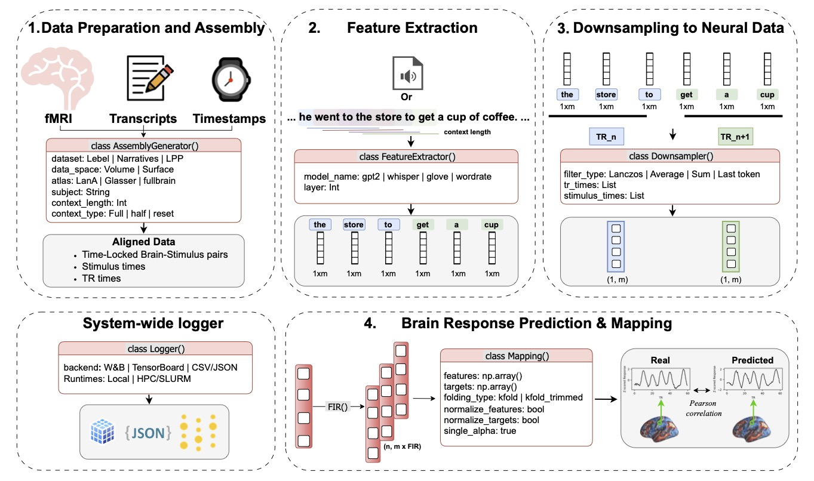

# LITcoder

This repository accompanies the paper "LITcoder: A General-Purpose Library for Building and Comparing Encoding Models" ([arXiv:2509.09152](https://www.arxiv.org/abs/2509.09152)). It provides a modular pipeline to align continuous stimuli with fMRI data, build encoding models, and evaluate them.




---

## 1) Prerequisites

- Python 3.10+

Environment setup:
```bash
git clone git@github.com:GT-LIT-Lab/litcoder_core.git
cd litcoder_core
conda create -n litcoder -y python=3.12.8
conda activate litcoder
conda install pip
pip install -e .
```

> **Important Notes:**
> - The package is installed in development mode (`-e` flag) for easy development and updates
> - PyPI package coming soon! Until then, use the development installation above
---


## 2) Quick setup from a prepackaged assembly (LeBel)
This shows how easy it is to train a model using LITcoder. The assembly, was created using the `AssemblyGenerator` class, which is part of the `encoding.assembly.assembly_generator` module.
Use the packaged LeBel assembly and train a wordrate-only model end-to-end. This assembly will help you get started with the library and understand the core components, and to better understand the tutorials.

First, download the Lebel pre-packaged assembly

```bash
gdown 1q-XLPjvhd8doGFhYBmeOkcenS9Y59x64
```

Then run the following:

```python
from encoding.assembly.assembly_loader import load_assembly
from encoding.features.factory import FeatureExtractorFactory
from encoding.downsample.downsampling import Downsampler
from encoding.models.nested_cv import NestedCVModel
from encoding.trainer import AbstractTrainer

# 1) Load prepackaged assembly
assembly_path = "assembly_lebel_uts03.pkl"
assembly = load_assembly(assembly_path)

# 2) Configure components (wordrate-only)
extractor = FeatureExtractorFactory.create_extractor(
    modality="wordrate",
    model_name="wordrate",
    config={},
    cache_dir="cache",
)

downsampler = Downsampler()
model = NestedCVModel(model_name="ridge_regression")

# FIR, downsampling, and trimming match our LeBel defaults
fir_delays = [1, 2, 3, 4]
trimming_config = {
    "train_features_start": 10, "train_features_end": -5,
    "train_targets_start": 0,  "train_targets_end": None,
    "test_features_start": 50,  "test_features_end": -5,
    "test_targets_start": 40,   "test_targets_end": None,
}

downsample_config = {}

# 3) Train
trainer = AbstractTrainer(
    assembly=assembly,
    feature_extractors=[extractor],
    downsampler=downsampler,
    model=model,
    fir_delays=fir_delays,
    trimming_config=trimming_config,
    use_train_test_split=True,
    logger_backend="wandb",
    wandb_project_name="lebel-wordrate",
    dataset_type="lebel",
    results_dir="results",
    downsample_config=downsample_config,
)

metrics = trainer.train()
print({
    "median_correlation": metrics.get("median_score", float("nan")),
    "n_significant": metrics.get("n_significant"),
})
```

Or run the ready-made script:

```bash
python train_simple.py
```

To download the assembly, use the following google drive link: [assembly_lebel_uts03.pkl](https://drive.google.com/file/d/1q-XLPjvhd8doGFhYBmeOkcenS9Y59x64/view?usp=sharing)

We recommend using this first for testing the installation. More details on how to create your own assembly will be added soon.
We will also be moving to a more scalable hosting solution for the assemblies in the very near future.

### 2.1) Tutorials for other modalities

- [Language Models](https://litcoder-brain.github.io/language-models.html)
- [Embeddings](https://litcoder-brain.github.io/embeddings.html)
- [Speech](https://litcoder-brain.github.io/speech.html)

Tutorials from documentation:
- [Language Models](https://gt-lit-lab.github.io/litcoder_core/tutorial_language_models.html)
- [Embeddings](https://gt-lit-lab.github.io/litcoder_core/tutorial_embeddings.html)
- [Speech](https://gt-lit-lab.github.io/litcoder_core/tutorial_speech.html)

### Supplied scikit-learn regressors

```python
from sklearn.linear_model import Ridge
from sklearn.pipeline import make_pipeline
from sklearn.preprocessing import StandardScaler

model = NestedCVModel(
    "scaled_ridge",
    estimator=make_pipeline(StandardScaler(), Ridge()),
    param_grid={"ridge__alpha": [0.1, 1.0, 10.0]},
)
```

Pass this model to `AbstractTrainer` or call `model.fit_predict` directly.
Omit `param_grid` to fit with the supplied parameters. Grid selection maximizes
mean finite Pearson correlation over inner validation folds and targets, using
one parameter setting for all targets. Ties use the first grid candidate.
Estimator fits, Pipeline transforms and optional LITCoder fold normalization
use the corresponding training subset. Legacy fMRI per-story standardization
is upstream of these fits. Pipeline caching must be disabled.
Use an explicit random seed for stochastic estimators.

The CPU path accepts cloneable regressors that fit NumPy float32 arrays and
predict a finite numeric value per row and target. Native mode uses a 1-D
target for one eligible column and requires advertised multi-output support
for multiple eligible columns. Set `target_mode="per_target"` to fit a separate
clone to each eligible column with the same selected parameters. Invalid targets
retain their positions. Supply estimator parameters in their own units.
For Ridge parity, use LITCoder's effective squared penalty as sklearn's
`alpha` and match intercept, normalization, and singular-value settings.
The built-in ridge path retains its existing convention.

Supplied estimators return `None` for the two ridge array summaries. Fitted
estimators and transforms are stored per fold and replayed with
`NestedCVModel.predict_fold` on the prepared design. Nested CV has no final
refit. Load pickle artifacts only from trusted sources with compatible
scikit-learn and custom estimator versions. The ECoG memory preflight uses
the existing design and ridge-workspace estimate. Estimator-specific memory
usage can exceed that estimate.

### Continuous ECoG

Use `ECoGAssemblyGenerator(data_dir).generate_assembly(subject)` with a version 1
`ecog.json` manifest, or pass preprocessed recording mappings as `recordings=`.
Each recording supplies a uniform neural grid, sampling rate, signal and time
units, ordered electrodes, transcript onsets, clocks or an explicit affine
synchronization, and preprocessing provenance. Supply `valid_samples` for
assessed-valid rows and optional disjoint `unknown_samples` for unannotated rows.
Rows in neither mask are known-invalid. Keep original rows and clocks through
gaps. Recordings pooled together must have the same electrode order and units.

Pass the assembly to `AbstractTrainer` with `fir_delays=None`,
`downsampler=None`, empty trimming and `ecog_temporal_config`. Supply one
`feature_specs` entry per extractor. Methods are `word_sum`, `word_mean`,
`word_last`, `words_per_bin`, `words_per_second`, and `speech_linear`.
Empty bins are zero. Declare missing stimulus intervals in neural seconds.
Speech needs mapped frame seconds, an origin and a maximum interpolation gap.
Interpolation can use future frames. Dependency intervals cover the known
context windows, carried-forward embeddings, and interpolation endpoints.
Stateful context resets conservatively depend on the preceding recording prefix.
Declare the full support of externally generated contexts, audio resampling
and other upstream operations. For speech, use identified immutable audio
because the cache keys by path. ECoG Lanczos, neural resampling and
event-aligned analysis are outside this path.

Set `delays_s` explicitly. Positive delays use earlier stimulus features.
Rounding is to the nearest sample, with ties away from zero. Negative delays
require `retrospective=True`. Use a configurable `memory_budget_bytes` for
preflight. The estimate covers the expanded design and major ridge arrays,
with feature extraction and exact process peak usage outside its guarantee.

For held-out descriptive Pearson scores, choose `protocol="blocked"` or
`"recording"` with an explicit embargo and justified neural preprocessing
support. Purges use original time coordinates. Dependency exclusion does not
establish independence. Inference is marked `not_assessed`. For an engineering
fit/replay check, choose `protocol="diagnostic_in_sample"` and supply one
positive built-in ridge alpha via `trainer.train(alphas=[...])`. This explicitly
admits finite unknown-quality rows while excluding known-invalid rows and
missing feature dependencies. Unknown neural preprocessing support is
preserved as unknown. The single diagnostic fit emits no held-out metrics
or significance outputs.

Load trusted artifacts with `ModelSaver.load_encoding_result`. Replay an
identified fit with `NestedCVModel.predict_fold` on the same prepared design
in the recorded feature and sample order. Synthetic validation exercises
the encoding path. Real-data loading/alignment and diagnostic replay do not
establish independent predictive performance or exact paper replication.

## 3) Quick tutorial:

This library uses the same core modules across datasets, here's an example for Narratives:
- Create an assembly with `dataset_type="narratives"`, providing `data_dir`, `subject`, `tr`, `lookback`, `context_type`, and `use_volume`.
- Build `LanguageModelFeatureExtractor`, extract all layers per story (with caching via `ActivationCache`), and select `layer_idx`.
- Downsample to TRs with `Downsampler.downsample(...)` using `--downsample_method` and Lanczos parameters if applicable.
- Apply FIR delays with `FIR.make_delayed` using `--ndelays`.
- Concatenate the delayed features and brain data for the story order used in the script (currently `['21styear']`), then trim `[14:-9]` before modeling.
- Fit nested CV ridge via `fit_nested_cv(features=X, targets=Y, ...)` with your chosen folding and ridge parameters.


Minimal code sketch:

```python
from encoding.assembly.assembly_generator import AssemblyGenerator
from encoding.features import LanguageModelFeatureExtractor, FIR
from encoding.downsample.downsampling import Downsampler
from encoding.models.nested_cv import fit_nested_cv
from encoding.utils import ActivationCache
import numpy as np

# 1) Assembly
assembly = AssemblyGenerator.generate_assembly(
    dataset_type="narratives",
    data_dir="data/narratives/neural_data",
    subject="sub-256",
    tr=1.5,
    lookback=256,
    context_type="fullcontext",
    use_volume=False,
)

# 2) Models
extractor = LanguageModelFeatureExtractor({
    "model_name": "gpt2-small",
    "layer_idx": 9,
    "last_token": True,
})
cache = ActivationCache(cache_dir="cache_narratives")
ds = Downsampler()

downsampled_X, brain_data = {}, {}
for story in assembly.stories:
    idx = assembly.stories.index(story)
    texts = assembly.get_stimuli()[idx]

    cache_key = cache._get_cache_key(
        story=story,
        lookback=256,
        model_name="gpt2-small",
        context_type="fullcontext",
        last_token=False,
        dataset_type="narratives",
        raw=True,
    )
    lazy_cache = cache.load_multi_layer_activations(cache_key)
    if lazy_cache is not None:
        features = lazy_cache.get_layer(9)
    else:
        all_layers = extractor.extract_all_layers(texts)
        cache.save_multi_layer_activations(cache_key, all_layers, metadata={})
        features = all_layers[9]

    split_indices = assembly.get_split_indices()[idx]
    data_times = assembly.get_data_times()[idx]
    tr_times = assembly.get_tr_times()[idx]

    downsampled_X[story] = ds.downsample(
        data=features,
        data_times=data_times,
        tr_times=tr_times,
        method="lanczos",
        split_indices=None,
        window=3,
        cutoff_mult=1.0,
    )
    brain_data[story] = assembly.get_brain_data()[idx]

# FIR delays
ndelays = 8
delays = range(1, ndelays + 1)
delayed_features = {s: FIR.make_delayed(downsampled_X[s], delays) for s in assembly.stories}

story_order = ["21styear"]
X = np.concatenate([delayed_features[s] for s in story_order], axis=0)
Y = np.concatenate([brain_data[s] for s in story_order], axis=0)

# Trimming
X = X[14:-9]
Y = Y[14:-9]

# 4) Model
metrics, weights, best_alphas = fit_nested_cv(
    features=X,
    targets=Y,
    folding_type="kfold_trimmed"
    n_outer_folds=5,
    n_inner_folds=5,
    chunk_length=20,
    singcutoff=1e-10,
    use_gpu=False,
    single_alpha=True,
    normalpha=True,
    use_corr=True,
    normalize_features=False,
    normalize_targets=False,
)
```
> **Note:** In order to run the code above, you need to have the data downloaded and preprocessed. See the [Litcoder_release](https://github.com/GT-LIT-Lab/litcoder_release) for more details.


## 4) Tutorials
We will be adding tutorials on the following websites:

- [LITcoder_core](https://litcoder-brain.github.io/tutorials.html)


## Project Status and Contributions

This repository is under active development. We will continue to add many features and improvements. The main components will not change, and any further updates should not affect your current experiments. Bug reports, feature requests, and pull requests are highly appreciated. Please open an issue or submit a PR; for larger changes, consider starting a discussion first.

---

## 🚧 Roadmap

### 📋 TODO

- [ ] **Add comprehensive test suite** - Unit tests, integration tests, and validation tests
- [ ] **Migrate to PyPI** - Package distribution and easy installation via `pip`
- [ ] **Google colab quickstart tutorial**

### 🔮 Future Enhancements

- [ ] **Documentation improvements** - API docs, tutorials, and examples
- [ ] **Additional model support** - More language models and architectures
- [ ] **Interactive demos** - Jupyter notebooks and web interfaces

---

*Contributions welcome! Please open an issue or submit a pull request.*


## Citation

If you use **LITcoder** in your research, please cite:
```bibtex
@inproceedings{
binhuraib2025litcoder,
title={{LIT}coder: A General-Purpose Library for Building and Comparing  Encoding Models},
author={Taha Osama A Binhuraib and Ruimin Gao and Anna A Ivanova},
booktitle={Data on the Brain {\&} Mind Findings},
year={2025},
url={https://openreview.net/forum?id=c9GUBrE5RV}
}
```
